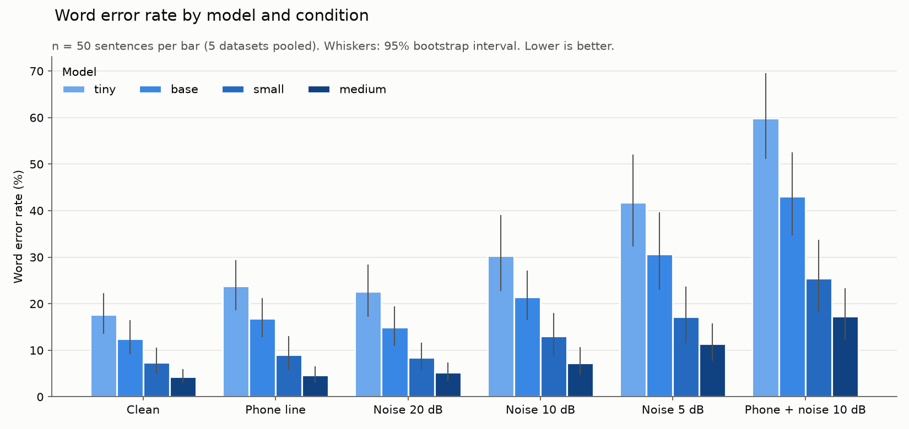
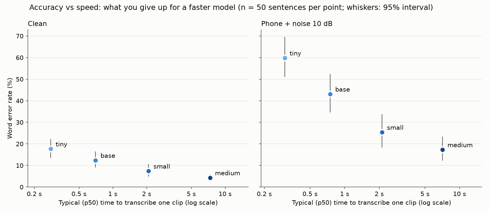
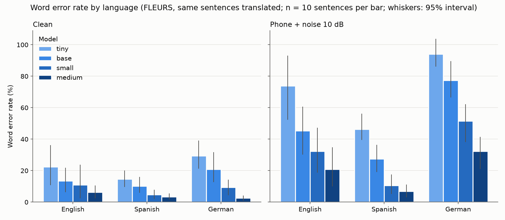

# asr-bench: which Whisper size should a contact centre ship?

A reproducible benchmark of open-source speech-to-text (Whisper, run locally) under contact-centre conditions: phone lines, background noise, and more than one language. It measures accuracy, speed and cost **together**, so a product team can choose a model per use case with evidence instead of a clean-audio leaderboard.

> **Status:** a complete, small-sample run (n = 50 sentences per model × condition, 1,200 transcriptions). Every number below comes from [`results/report.md`](results/report.md), which `make report` generates from [`results/results.csv`](results/results.csv). Recommendations are in [`RECOMMENDATIONS.md`](RECOMMENDATIONS.md).

---

## 1. Problem

Contact-centre speech AI (live captions, call transcripts, summaries, quality checks) is only as good as the transcription underneath. Teams often pick a speech model from a leaderboard measured on **clean studio audio**, then find in production that phone lines and background noise make it much worse, and that the accurate models are too slow or too expensive for live use.

**The question:**
> Which Whisper model size should you ship for which contact-centre use case, given accuracy, latency and cost, once audio is noisy, narrowband (telephone) and multilingual?

**Who it's for:** a product manager choosing a model for (a) live captions, (b) post-call transcripts, (c) analytics and summaries; and an engineer who wants a harness to re-run when a new model ships.

**Non-goals:** no model training, no real customer audio (public data only), no claims about any company's systems, no web UI.

## 2. Method

| | What we did | More detail |
|---|---|---|
| **Data** | Public read speech: LibriSpeech (English audiobooks, "clean" and "other" sets) and FLEURS (the same sentences in English, Spanish and German). 10 sentences per dataset, chosen by a fixed random seed. | [DATA.md](DATA.md) |
| **Conditions** | The *same* sentences under 6 conditions: clean; phone line (300–3,400 Hz); pink noise at 20, 10 and 5 dB; phone + noise (noise in the caller's room, 10 dB at the agent's end). Every model hears identical noise. | [CONCEPTS.md §4–10](CONCEPTS.md) |
| **Models** | Whisper `tiny`, `base`, `small`, `medium` via faster-whisper, CPU, int8, 4 threads, beam size 5, language given to the model. | [SPEC.md](SPEC.md) |
| **Accuracy** | WER (word error rate) after cleaning both texts with Whisper's normalisation rules. Overall WER = total errors ÷ total words. | [CONCEPTS.md §12–14](CONCEPTS.md) |
| **Speed** | Time to transcribe each whole clip (p50 typical, p95 slow), and RTF (processing time ÷ audio length). Measured on an Apple M4 laptop CPU. | [CONCEPTS.md §15–16](CONCEPTS.md) |
| **Cost** | Per 1,000 audio minutes: self-hosted (RTF × AWS c7g.xlarge at $0.145/h) vs Amazon Transcribe ($0.006/min batch, $0.01/min streaming). These are assumptions set in [`config.yaml`](config.yaml). | [CONCEPTS.md §23](CONCEPTS.md) |
| **Uncertainty** | 95% bootstrap intervals on every WER. Model-vs-model comparisons are paired on the same sentences. Each hypothesis has a written rule that decides its verdict. | [CONCEPTS.md §19–22](CONCEPTS.md) |

## 3. Results

### Accuracy: WER % by model and condition (n = 50 sentences per cell; [95% interval])

| Model | Clean | Phone line | Noise 20 dB | Noise 10 dB | Noise 5 dB | Phone + noise 10 dB |
|---|---|---|---|---|---|---|
| tiny | 17.7 [13.5–22.2] | 23.8 | 22.6 | 30.3 | 41.8 | 59.9 [51.1–69.6] |
| base | 12.4 [9.1–16.5] | 16.8 | 14.9 | 21.5 | 30.7 | 43.1 [34.6–52.5] |
| small | 7.4 [4.9–10.6] | 9.0 | 8.5 | 13.1 | 17.2 | 25.4 [18.3–33.7] |
| medium | 4.3 [3.0–5.9] | 4.6 | 5.2 | 7.3 | 11.5 | 17.3 [12.2–23.4] |

Every step up in size (tiny → base → small → medium) is a **clear** improvement in every condition (paired comparison; intervals in the report).



### Speed and cost (all 300 clips per model)

| Model | Typical clip (p50) | Slow clip (p95) | RTF | Self-hosted $ / 1,000 min | Amazon Transcribe $ / 1,000 min |
|---|---|---|---|---|---|
| tiny | 0.29 s | 2.49 s | 0.068 | $0.16 | $6 batch / $10 streaming |
| base | 0.70 s | 2.28 s | 0.106 | $0.26 | $6 / $10 |
| small | 2.06 s | 3.65 s | 0.254 | $0.61 | $6 / $10 |
| medium | 7.29 s | 13.70 s | 0.871 | $2.10 | $6 / $10 |

On this laptop CPU, `medium` takes about 0.87 s per second of audio: **barely real time**. Self-hosted cost is a floor (a fully busy server, no engineering or redundancy), and the hosted API's *accuracy* was not measured.



### Hypotheses: what the data says

| # | Hypothesis | Verdict | Evidence in one line |
|---|---|---|---|
| H1 | Gaps between sizes widen under phone and noise | **Partly supported** | The tiny–medium gap grows from 13.4 points (clean) to 42.6 (phone + noise), clear in all 5 degraded conditions. Small vs medium widens clearly in 3 of 5. |
| H2 | A mid-size model gives most of the largest's accuracy at a fraction of the latency | **Unclear** | `small` achieves 75–81% of the tiny → medium improvement at 28% of medium's latency. The intervals straddle the 80% threshold we set for "most". |
| H3 | Non-English degrades more than English | **Partly supported** | **German** degrades clearly more in 12 of 20 model × condition comparisons. **Spanish** never clearly more, and clearly *less* in 2. This contradicts the hypothesis for Spanish. |
| H4 | Normalisation can flip a model ranking | **Partly supported** | The rules shift WER by up to ~6 points (lower-case-only vs Whisper rules) but changed **no** overall ranking. Only 3 of 30 small per-dataset cells swapped. |



Full tables, intervals and rules: [`results/report.md`](results/report.md).

## 4. Limitations

- **Read speech is easier than real calls.** No hesitations, interruptions, cross-talk or stressed speech.
- **Synthetic noise is not real noise.** Steady pink noise is easier than babble, music or a TV.
- **Single-speaker audio, no diarisation.** Who-said-what is not measured.
- **CPU-only timings are not production timings.** One laptop CPU, no GPU, no batching.
- **Small sample.** 50 sentences per model × condition, 10 per dataset. Intervals are wide, and per-language results are especially uncertain.
- **Telephony is band-limiting only.** No codec compression, packet loss or echo.
- **Hosted-API accuracy not measured.** Only its price is compared.
- **Possible training overlap.** Whisper may have seen similar public audio.

## 5. What I would do next in production

_Draft for the owner to edit._

1. **Test on real calls.** Run the same harness on consented, de-identified call recordings with real speaker turns. Read speech flatters every model.
2. **Measure what live captions actually feel like.** Simulate streaming (audio arriving in small chunks) and measure caption delay, rather than whole-clip processing time.
3. **Benchmark the real deployment hardware.** GPU and batched inference on the target server change the speed and cost picture completely. CPU laptop timings are only a relative guide.
4. **Compare against hosted APIs on accuracy, not just price.** Run Amazon Transcribe (and others) on the same clips and conditions.
5. **Add diarisation and two-channel audio**, since agent and customer are usually recorded separately.
6. **Grow the sample** until the decisions that matter (for example small vs medium for post-call) are clear, not just plausible. The harness resumes, so this costs only the new sentences.
7. **Deferred from this exercise** ([SPEC §13](SPEC.md)): `large-v3-turbo`, Hindi with character error rate, automatic language detection, a phone codec, real recorded noise, and number normalisation for Spanish and German.
8. **Monitor in production.** Sample real calls and track WER over time, so model drift or a new phone vendor shows up before customers notice.

## 6. Quick start (macOS, Apple Silicon)

Prerequisites: [uv](https://docs.astral.sh/uv/) and `make` (comes with Xcode Command Line Tools). No `sudo` needed.

```bash
git clone <this repo> asr-bench && cd asr-bench
make install   # create the Python environment (seconds)
make data      # download public datasets into data/ (~2.1 GB; minutes, depends on connection)
make test      # 55 unit tests (seconds)
make smoke     # 5 sentences, tiny model, 150 clips (~1.5 min, plus a 75 MB model download the first time)
make bench     # full run: 4 models, 1,200 clips (~1 hour on an M4, plus ~2.1 GB of models the first time)
make report    # rebuild results/report.md and charts (seconds)
```

Other commands: `uv run asr-bench sample --n 5` shows the seeded sentences, and `uv run asr-bench listen` saves one sentence in all 6 conditions to `data/examples/`, so you can hear them.

A crashed or interrupted `make bench` resumes where it stopped. Data, audio and model files stay in `data/` and are never committed.

## 7. How to extend

| You want to… | Do this |
|---|---|
| **Add a Whisper size** (e.g. `large-v3-turbo`) | Add it to `models:` in `config.yaml`, record its licence in `DATA.md`, then run `make bench`. Only the new model runs. Check run time first with `uv run asr-bench run --models large-v3-turbo --n 2 --out results/probe.csv --fresh`. |
| **Grow the sample** | Raise `sample_size:` in `config.yaml` and run `make bench`. Only the new sentences run, because smaller samples are the start of larger ones. |
| **Add a FLEURS language** | Add its locale to `FLEURS_LOCALES` in `src/asr_bench/data.py` and a dataset entry in `config.yaml`, then run `make data`, `make bench` and `make report`. Non-Latin scripts need a better normaliser and CER first (see SPEC §13). |
| **Add a condition** | Add an entry under `conditions:` in `config.yaml` (`snr_db`, `telephony`). New kinds of degradation go in `src/asr_bench/conditions.py` with a test in `tests/test_conditions.py`. |
| **Change prices** | Edit `cost:` in `config.yaml`, then run `make report`. No re-run needed. |
| **Add a normalisation rule** | Add it to `RULES` and `rescore` in `src/asr_bench/report.py`, then run `make report`. |
| **Change a setting that affects results** (beam size, threads, seed) | Use a new results file or `--fresh`. The run refuses to mix rows made with different settings. |

## 8. Repository map

| File / folder | What it is |
|---|---|
| [`SPEC.md`](SPEC.md) | The spec, including a decisions log (§12) and future enhancements (§13) |
| [`DATA.md`](DATA.md) | Datasets, model licences, attribution |
| [`CONCEPTS.md`](CONCEPTS.md) | Plain-English revision sheet with analogies |
| [`LEARNING.md`](LEARNING.md) | Build diary: what each file does, step by step |
| [`RECOMMENDATIONS.md`](RECOMMENDATIONS.md) | Model choice per use case (owner-written) |
| `config.yaml` | Every setting: models, datasets, conditions, sample size, prices |
| `src/asr_bench/` | `data.py` (download and sample), `conditions.py` (phone and noise), `transcribe.py` (Whisper), `metrics.py` (WER, intervals, cost), `run.py` (resumable loop), `report.py` (report and charts), `cli.py` (commands) |
| `tests/` | 55 unit tests; fake data and fake models keep them fast |
| `results/` | `results.csv` (every transcription), `report.md`, `charts/` |

## Licence and credits

Code: [MIT](LICENSE). Datasets: LibriSpeech and FLEURS, both CC BY 4.0 (attribution in [DATA.md](DATA.md)). Models: OpenAI Whisper via the Systran faster-whisper conversions (MIT).
