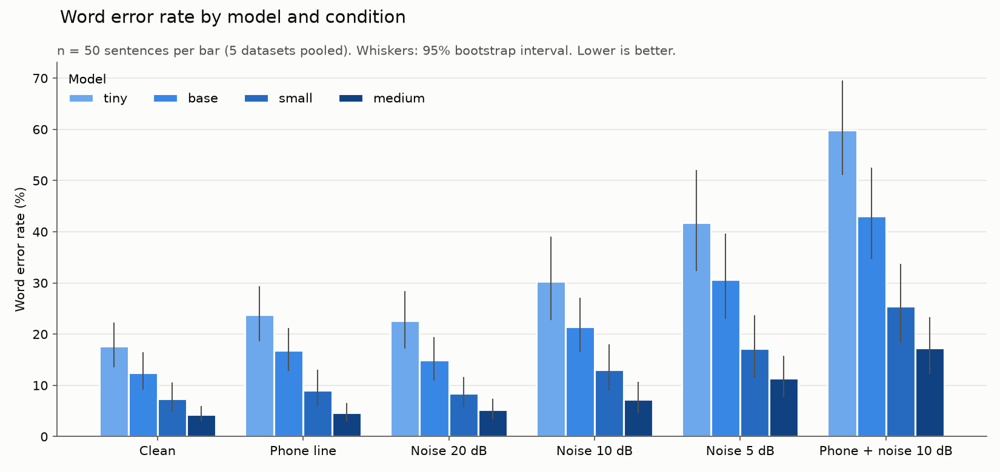
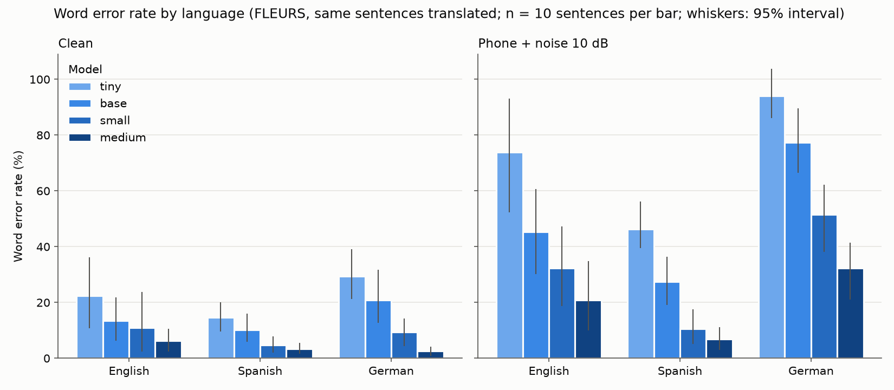
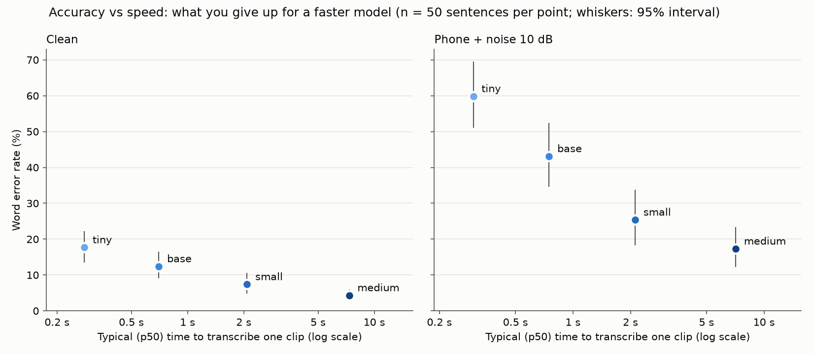

# asr-bench report

_Generated by `make report` from `results/results.csv`. Do not edit by hand; re-run to rebuild._

## What was tested
- **Models:** tiny, base, small, medium (faster-whisper, int8, CPU, 4 threads, beam size 5; language given to the model).
- **Machine:** Apple M4 laptop, CPU only (4 performance cores used).
- **Data:** fleurs_de, fleurs_en, fleurs_es, librispeech_test_clean, librispeech_test_other. **10 sentences per dataset** (seed 42), so **n = 50 sentences** per model × condition.
- **Conditions:** Clean, Phone line, Noise 20 dB, Noise 10 dB, Noise 5 dB, Phone + noise 10 dB. Noise is synthetic pink noise; "Phone + noise" adds the noise in the caller's room, then sends it through the phone line, tuned to 10 dB at the far end.
- **Clips:** 1200 transcriptions in total.

## How to read this report
- **WER** = word errors per 100 reference words. Lower is better.
- **[a–b]** = 95% bootstrap interval. With this many sentences, the true WER could plausibly be anywhere in that range.
  Where two models' comparison interval includes zero, **this data cannot tell them apart**.
- This is a **small sample**. Treat differences of a few points with caution unless the comparison table says they are clear.

## Accuracy

### WER by model and condition (all datasets, n = 50 sentences per cell)

| Model | Clean | Phone line | Noise 20 dB | Noise 10 dB | Noise 5 dB | Phone + noise 10 dB |
|---|---|---|---|---|---|---|
| tiny | 17.7 [13.5–22.2] | 23.8 [18.7–29.3] | 22.6 [17.2–28.4] | 30.3 [22.8–39.1] | 41.8 [32.3–52.0] | 59.9 [51.1–69.6] |
| base | 12.4 [9.1–16.5] | 16.8 [12.9–21.2] | 14.9 [10.9–19.5] | 21.5 [16.5–27.1] | 30.7 [23.0–39.6] | 43.1 [34.6–52.5] |
| small | 7.4 [4.9–10.6] | 9.0 [5.8–13.1] | 8.5 [5.7–11.7] | 13.1 [8.9–18.0] | 17.2 [11.5–23.7] | 25.4 [18.3–33.7] |
| medium | 4.3 [3.0–5.9] | 4.6 [3.0–6.5] | 5.2 [3.4–7.3] | 7.3 [4.6–10.7] | 11.5 [7.7–15.8] | 17.3 [12.2–23.4] |

### WER by model and dataset (all conditions pooled, n = 10 sentences × 6 conditions per cell)

| Model | fleurs_de | fleurs_en | fleurs_es | librispeech_test_clean | librispeech_test_other |
|---|---|---|---|---|---|
| tiny | 61.6 [55.0–70.4] | 34.4 [22.7–46.6] | 24.7 [19.5–31.3] | 9.1 [5.2–13.8] | 25.0 [19.6–34.7] |
| base | 43.8 [37.5–51.5] | 22.0 [14.6–29.4] | 16.0 [11.8–22.0] | 6.3 [2.3–10.2] | 23.4 [17.5–32.8] |
| small | 26.2 [19.4–32.6] | 15.6 [7.3–27.0] | 6.9 [3.6–10.6] | 2.7 [1.0–4.6] | 13.9 [7.8–22.8] |
| medium | 13.5 [8.3–19.3] | 9.7 [4.1–16.7] | 4.4 [2.3–7.2] | 0.9 [0.0–2.4] | 13.1 [8.7–19.8] |

## Speed and cost

Per clip, over all 300 clips per model. Latency is the time to transcribe a **whole clip** (batch), not live-caption delay. RTF = processing time ÷ audio length (below 1 = faster than real time).

| Model | Latency p50 (s) | Latency p95 (s) | RTF | Self-hosted $ / 1,000 audio min | Hosted API $ / 1,000 audio min |
|---|---|---|---|---|---|
| tiny | 0.29 | 2.49 | 0.068 | $0.16 | $6.00 |
| base | 0.70 | 2.28 | 0.106 | $0.26 | $6.00 |
| small | 2.06 | 3.65 | 0.254 | $0.61 | $6.00 |
| medium | 7.29 | 13.70 | 0.871 | $2.10 | $6.00 |

**Cost assumptions (from `config.yaml`; prices change, so check before relying on them):**
- *Self-hosted* = 1,000 × RTF ÷ 60 hours × $0.145/hour. The server is AWS EC2 c7g.xlarge, on-demand, US East. This assumes the server runs as fast as the test machine and is fully used. Real deployments add idle time, redundancy and engineering cost.
- *Hosted API* = Amazon Transcribe standard **batch** at $0.006/min. **Streaming** (needed for live captions) is $0.01/min = $10.00 per 1,000 minutes.
- The hosted API's accuracy was **not** measured here; only its price is shown.

## Can we tell them apart?

Each neighbouring pair of sizes, judged on the **same** sentences. The number is how many WER points the larger model saves, with its 95% interval. **Clear** = the interval is entirely above zero.

| Condition | tiny → base | base → small | small → medium |
|---|---|---|---|
| Clean | 5.3 [2.6–8.3] **clear** | 5.0 [2.5–7.7] **clear** | 3.1 [1.1–5.5] **clear** |
| Phone line | 6.9 [3.9–10.1] **clear** | 7.8 [5.0–10.8] **clear** | 4.4 [2.2–7.3] **clear** |
| Noise 20 dB | 7.7 [4.7–10.9] **clear** | 6.4 [4.0–9.2] **clear** | 3.3 [1.3–5.4] **clear** |
| Noise 10 dB | 8.9 [4.5–14.6] **clear** | 8.4 [5.7–11.1] **clear** | 5.8 [3.1–9.2] **clear** |
| Noise 5 dB | 11.1 [6.8–15.4] **clear** | 13.5 [9.5–18.2] **clear** | 5.8 [2.7–9.0] **clear** |
| Phone + noise 10 dB | 16.7 [11.9–21.7] **clear** | 17.7 [12.5–23.5] **clear** | 8.1 [4.5–11.9] **clear** |

## Hypotheses

_Verdicts follow the stated rules. They report what this sample shows, not what we expected._

### H1. Accuracy gaps between model sizes widen under telephony and noise

**Test:** gap = WER(smaller) − WER(larger). For each degraded condition: how much bigger is the gap than on clean audio (WER points), on the same sentences. **Clear** = interval above zero.

| Condition | Gap widening tiny vs medium | Gap widening small vs medium |
|---|---|---|
| Phone line | 5.8 [2.5–9.2] **clear** | 1.3 [0.1–2.7] **clear** |
| Noise 20 dB | 4.0 [1.3–7.1] **clear** | 0.2 [-1.2–1.7] |
| Noise 10 dB | 9.6 [4.3–16.0] **clear** | 2.7 [0.1–5.3] **clear** |
| Noise 5 dB | 16.9 [10.8–23.8] **clear** | 2.7 [-1.1–6.5] |
| Phone + noise 10 dB | 29.2 [21.8–36.5] **clear** | 5.0 [0.7–9.2] **clear** |

**Verdict:** **Partly supported** (8 of 10 comparisons clear).

### H2. A mid-size model gives most of the accuracy of the largest (medium) at a fraction of the latency

**Test:** accuracy share = how much of the tiny → medium WER improvement a model achieves (100% = as good as medium). Latency share = its p50 latency ÷ medium's. **Rule (a product judgement, set in `report.py`):** supported if the share's interval stays ≥ 80% and latency is ≤ 50% of medium's.

Latency share (all clips): base 10%, small 28%.

| Condition | Accuracy share: base | Accuracy share: small |
|---|---|---|
| Clean | 40% [22%–56%] | 77% [63%–91%] |
| Phone line | 36% [23%–48%] | 77% [65%–88%] |
| Noise 20 dB | 44% [32%–56%] | 81% [72%–92%] |
| Noise 10 dB | 38% [24%–52%] | 75% [64%–85%] |
| Noise 5 dB | 37% [25%–47%] | 81% [73%–90%] |
| Phone + noise 10 dB | 39% [30%–49%] | 81% [73%–89%] |

**Verdict:** **Unclear** for small: its accuracy share is close to 80% and the interval includes the threshold in every condition.

### H3. Non-English languages degrade more than English under the same conditions

**Test (FLEURS only, the same sentences translated into each language):** degradation = WER(condition) − WER(clean), in points. The table shows how much **more** a language degrades than English. Positive = degrades more. **Clear** = interval entirely on one side of zero. Languages have different sentence samples, so they are re-drawn independently (n = 10 sentences per language).

| Model | Condition | Extra degradation: Spanish vs English | Extra degradation: German vs English |
|---|---|---|---|
| tiny | Phone line | -1.6 [-10.6–6.7] | 10.8 [-0.4–22.4] |
| tiny | Noise 20 dB | -0.7 [-4.9–5.2] | 12.6 [4.3–24.8] **more** |
| tiny | Noise 10 dB | 4.4 [-2.3–13.3] | 33.9 [16.2–56.6] **more** |
| tiny | Noise 5 dB | 6.3 [-3.9–16.1] | 51.3 [36.0–71.8] **more** |
| tiny | Phone + noise 10 dB | -19.9 [-43.4–4.2] | 13.1 [-12.1–39.9] |
| base | Phone line | -4.5 [-10.7–1.0] | -1.1 [-9.0–5.7] |
| base | Noise 20 dB | -0.9 [-5.5–4.0] | 3.5 [-3.1–8.9] |
| base | Noise 10 dB | 2.2 [-5.3–10.6] | 20.8 [12.2–30.7] **more** |
| base | Noise 5 dB | 1.3 [-7.8–9.7] | 38.4 [21.1–58.8] **more** |
| base | Phone + noise 10 dB | -14.4 [-32.8–2.0] | 24.8 [4.0–44.8] **more** |
| small | Phone line | -0.5 [-3.4–1.9] | 1.0 [-4.0–7.6] |
| small | Noise 20 dB | -1.2 [-3.9–0.7] | 1.4 [-2.3–5.2] |
| small | Noise 10 dB | 0.7 [-2.6–4.0] | 19.0 [11.8–25.3] **more** |
| small | Noise 5 dB | 1.5 [-10.2–12.1] | 30.6 [15.6–45.2] **more** |
| small | Phone + noise 10 dB | -15.6 [-29.9–-2.6] **less** | 20.8 [1.5–36.9] **more** |
| medium | Phone line | -0.7 [-2.4–0.5] | 2.6 [-1.1–7.7] |
| medium | Noise 20 dB | 0.7 [-2.2–4.0] | 1.7 [-2.0–6.4] |
| medium | Noise 10 dB | -1.7 [-6.8–1.2] | 8.6 [0.6–19.0] **more** |
| medium | Noise 5 dB | -2.1 [-7.9–2.3] | 17.1 [8.4–25.5] **more** |
| medium | Phone + noise 10 dB | -11.2 [-23.2–-1.7] **less** | 15.2 [1.1–27.8] **more** |

- **Spanish:** clearly degrades more than English in 0 of 20 model × condition comparisons, clearly less in 2, unclear in 18.
- **German:** clearly degrades more than English in 12 of 20 model × condition comparisons, clearly less in 0, unclear in 8.

**Verdict:** **Partly supported** (12 of 40 comparisons clear). Absolute points are used; a language that starts with a higher clean WER has more room to degrade.

### H4. Normalisation choices can change WER enough to flip a model ranking

**Test:** re-score the saved raw transcripts under three rules (no models re-run), then compare model rankings with the main (Whisper) rule.

- `whisper`: Whisper rules (English rules for English, basic rules otherwise) — the main results
- `basic_all`: Basic rules for every language (no English number/spelling handling)
- `lowercase`: Lower-case only (punctuation kept)

**Overall WER by rule (all conditions and datasets):**

| Model | `whisper` | `basic_all` | `lowercase` |
|---|---|---|---|
| tiny | 32.7 | 33.1 | 38.3 |
| base | 23.2 | 23.6 | 28.9 |
| small | 13.4 | 13.8 | 18.9 |
| medium | 8.4 | 8.8 | 14.3 |

**Ranking changes vs the Whisper rule** (a change = two models swap order; ties don't count). Examples are written best → worst:

- `basic_all`: overall ranking changed in 0 of 6 conditions; per dataset × condition cell (n = 10 sentences each) in 0 of 30 cells.
- `lowercase`: overall ranking changed in 0 of 6 conditions; per dataset × condition cell (n = 10 sentences each) in 3 of 30 cells.

Examples: librispeech_test_other / Noise 20 dB under `lowercase`: small < medium < tiny < base → small < medium < base < tiny; librispeech_test_clean / Noise 10 dB under `lowercase`: medium < small < base < tiny → medium < small < tiny < base; librispeech_test_other / Noise 10 dB under `lowercase`: medium < small < tiny < base → medium < small < base < tiny.

**Verdict:** **Partly supported**: rankings changed only in small per-dataset cells, not overall. Note that rankings in small cells can also differ by chance, so cell-level flips mainly show how fragile small-sample rankings are.

## Limitations
- **Read speech is easier than real calls.** LibriSpeech and FLEURS are people reading prepared text clearly: no hesitations, interruptions, accents under stress, or cross-talk.
- **Synthetic noise is not real noise.** Steady pink noise is easier to "see through" than babble, music or a TV.
- **Single-speaker audio, no diarisation.** Real calls have two or more speakers, and separating who said what is not measured.
- **CPU-only timings are not production timings.** Speeds were measured on one laptop CPU, with no GPU and no batching. A production server could be much faster or slower.
- **Small sample.** n = 50 sentences per model × condition, and 10 per dataset. Intervals are wide, and close models often cannot be separated.
- **Telephony is band-limiting only.** No phone codec compression, packet loss or echo.
- **Hosted-API accuracy not measured.** Only its price is compared.
- **Possible training overlap.** Whisper may have seen similar public audio in training, which could flatter its results on these datasets.
